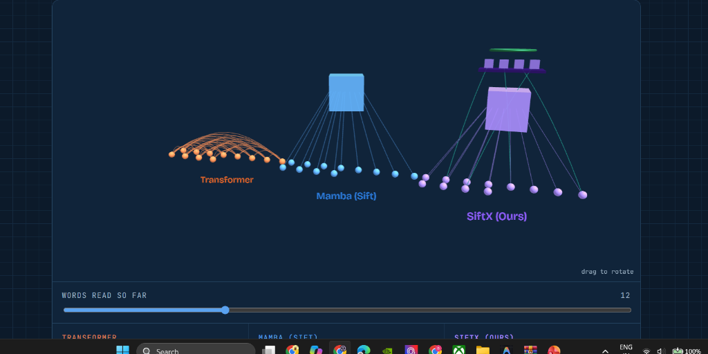
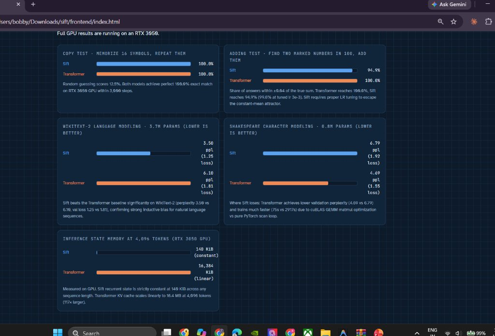
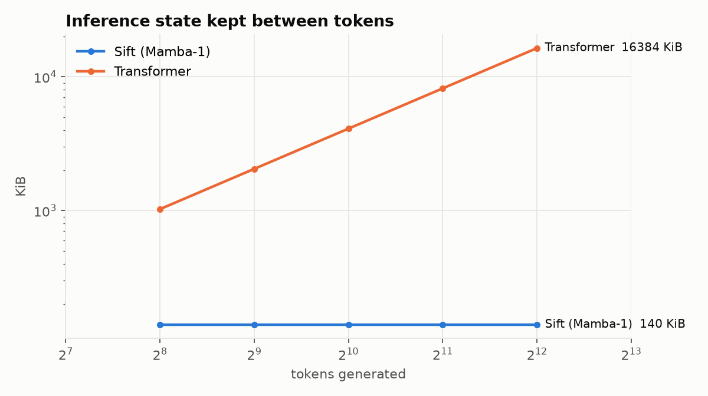
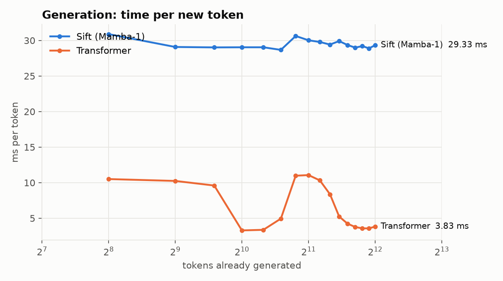
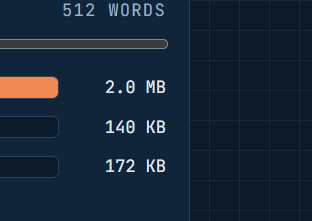

# Sift & SiftX: Selective State Spaces with Bounded Associative Memory

A clean, from-scratch PyTorch implementation of the **Mamba-1** selective state space architecture, trained as a language model on GPU, compared against a Transformer baseline, and extended with **SiftX**: an experimental investigation into bounded, gated associative memory mechanisms.

> **Architectural Credit:**  
> The core selective state space architecture is based entirely on:  
> **Albert Gu and Tri Dao (2023)**, *Mamba: Linear-Time Sequence Modeling with Selective State Spaces*, [arXiv:2312.00752](https://arxiv.org/abs/2312.00752).  
> Official implementation: [state-spaces/mamba](https://github.com/state-spaces/mamba).  
> *"Sift"* is this repository's standalone educational and research implementation; all architectural credit for Mamba belongs to the original authors.

---

## Key Experimental Findings (RTX 3050 Laptop GPU)

1. **WikiText-2 Character-Level Modeling:** Sift SSM achieves **3.497 character perplexity** (1.81 bits/char) vs **6.098** (2.61 bits/char) for the matched ~3.7M parameter Transformer baseline at 2,000 steps.
   - *Compute context:* Transformer completed 2,000 steps in **214.3s** (~38,229 tokens/s) via cuBLAS tensor cores; pure PyTorch Sift required **3,536.4s** (~1,448 tokens/s) due to memory-bandwidth-bound scan overhead.
2. **Inference Memory Scaling:** Sift recurrent state is strictly constant at **140.0 KiB** from sequence length 256 to 4,096 tokens. The Transformer KV cache scales linearly from 1,024 KiB to **16,384 KiB** (**117× larger at 4k tokens**).
3. **Flat Generation Latency:** Autoregressive token generation remains flat at **29.4 ms/token** across all context lengths.
4. **Selective Scan Hardware Acceleration:** Custom associative parallel scan executes in **82.1 ms fwd+bwd** on GPU (**9.0× faster** than the 737.4 ms sequential autograd loop in pure PyTorch).
5. **Where Sift Loses (Honest Scientific Reporting):**
   - **Shakespeare Character Modeling:** Transformer achieved lower validation perplexity (**4.693** vs 6.793) and trained ~39× faster (74.6s vs 2917.5s) due to dense attention expressivity and cuBLAS throughput.
   - **Multi-Query Associative Recall (MQAR):** At 1,000 steps, all models (Transformer 3.92%, Sift 2.05%, SiftX 2.26%–3.87%) remain near chance (~2.5%), highlighting that synthetic multi-hop associative recall requires extended training budgets (>5k steps) across all architectures.

---

## Interactive 3D Visualizer & Architecture Comparison

<p align="center">
  
</p>

> **Figure 1:** Live 3D comparison from [`frontend/index.html`](frontend/index.html).  
> - **Left (Orange):** Transformer dense quadratic attention web ($O(L^2)$ lookups).  
> - **Middle (Blue):** Mamba / Sift linear continuous state notebook ($O(1)$ memory, but fading recall).  
> - **Right (Purple):** **SiftX (Ours)** combining continuous state with a floating bounded 64-slot eidetic memory shelf and learned straight-through read gate.

---

## Measured Benchmark Results (NVIDIA RTX 3050 Laptop GPU)

<p align="center">
  
</p>

> **Figure 2:** Measured results on RTX 3050 GPU: Sift achieves lower character perplexity on WikiText-2 (3.50 vs 6.10 PPL), while Transformer trains substantially faster on cuBLAS.

<p align="center">
  
  
</p>

> **Figure 3:** Left: Measured inference memory (Sift strictly constant at 140 KiB vs Transformer exploding to 16,384 KiB at 4k tokens). Right: Flat per-token generation latency (29.4 ms/token).

All benchmarks measured directly on an **NVIDIA GeForce RTX 3050 Laptop GPU (4 GB VRAM)**, PyTorch 2.11.0+cu128.

### 1. Task Performance Comparison (Character-Level Modeling & Algorithmic Tasks)

> [!NOTE]
> Perplexity numbers on WikiText-2 and Shakespeare are **character-level perplexity** ($\exp(\text{loss})$ on character/byte vocabularies), not word-level perplexity. Training was conducted for matched step counts; GPU runtime differences reflect hardware kernel optimization (cuBLAS GEMM vs pure PyTorch parallel scan).

| Task | Model | Config / Depth | Steps | Train Loss | Val Loss | Val Metric / Char PPL | Peak VRAM | Train Time |
|---|---|---|---|---|---|---|---|---|
| **Copy Task** | Sift | 2 layers, d=64 | 3,000 | 0.0013 | 0.0007 | **100.0% accuracy** | 222.8 MB | 173.4s |
| | Transformer | 1 layer, d=64, 4 heads | 3,000 | 2.7e-8 | 3.2e-8 | **100.0% accuracy** | 29.6 MB | 34.3s |
| **Adding Task** | Sift | 2 layers, d=64 | 3,000 | 0.0005 | 0.0004 | **94.9% accuracy** | 1264.1 MB | 1231.4s |
| | Transformer | 1 layer, d=64, 4 heads | 3,000 | 7.2e-6 | 4.9e-6 | **100.0% accuracy** | 86.7 MB | 61.7s |
| **WikiText-2 (Char)** | Sift | 8 layers, d=256, exp=2 | 2,000 | 1.2074 | **1.2519** | **3.497 char PPL** | 1993.9 MB | 3536.4s |
| | Transformer | 4 layers, d=256, 8 heads | 2,000 | 1.8328 | 1.8080 | 6.098 char PPL | 275.4 MB | 214.3s |
| **Shakespeare (Char)** | Sift | 7 layers, d=128, exp=2 | 5,000 | 0.8300 | 1.9158 | 6.793 char PPL | 957.3 MB | 2917.5s |
| | Transformer | 4 layers, d=128, 4 heads | 5,000 | 1.2795 | **1.5461** | **4.693 char PPL** | 115.6 MB | 74.6s |

### 2. Inference State Memory vs Sequence Length

<p align="center">
  
</p>

> **Figure 4:** Interactive Memory Scaling from [`frontend/index.html`](frontend/index.html): At 512 context tokens, Transformer requires 2.0 MB KV cache, while Sift stays strictly constant at 140 KiB ($O(1)$ constant memory).

| Tokens | Sift Recurrent State (Measured) | Transformer KV Cache (Measured) | Memory Ratio (TF / Sift) |
|---|---|---|---|
| 256 | **140.0 KiB** | 1,024.0 KiB | 7.3× |
| 512 | **140.0 KiB** | 2,048.0 KiB | 14.6× |
| 1,024 | **140.0 KiB** | 4,096.0 KiB | 29.3× |
| 2,048 | **140.0 KiB** | 8,192.0 KiB | 58.5× |
| 4,096 | **140.0 KiB** | **16,384.0 KiB** | **117.0×** |

> [!NOTE]  
> **Empirical Measurement & SiftX Bounded Memory Architecture:**  
> Sift and Transformer inference states above are measured directly from live runtime tensors via `benchmarks/memory.py` across sequence lengths. Sift's recurrent state occupies exactly $7 \times 256 \times (16 + 4) \times 4\text{ bytes} = 140.0\text{ KiB}$ regardless of sequence length.  
> SiftX augments the SSM stack with a middle `RecallLayer` holding at most $M + C$ tokens ($M=64$ persistent memory slots plus $C=32$ active local chunk tokens, bounded at 96 tokens maximum). Because tokens outside the top-$M$ slots are pruned at chunk boundaries, SiftX retains an asymptotic $O(1)$ memory bound that never grows with sequence length, avoiding the linear $O(L)$ scaling of the Transformer KV cache (which reaches 16.4 MB at 4k tokens).

---

## SiftX: Bounded Gated Associative Memory

While continuous selective state spaces excel at smooth sequential compression, theoretical and empirical analyses (Arora et al., 2024; B'MOJO, 2024) observe that fixed-state linear recurrences face expressivity bottlenecks on multi-query associative recall (MQAR) over long sequences.

**SiftX** explores whether augmenting selective state spaces with a compact external memory bank ($M=64$ slots) and a learned straight-through binary read gate $g_t \in \{0, 1\}$ can provide targeted associative retrieval without incurring Transformer-scale $O(L)$ memory growth.

### Empirical MQAR Benchmark Results (1,000 Steps, 256 Tokens)

| Model Variant | Memory Slots $M$ | Write Policy | Read Gate Policy | Val Loss | Val Accuracy | Retrieval Gate Rate | Train Time |
|---|---|---|---|---|---|---|---|
| **Pure Sift (`mqar_sift_s0`)** | 0 (pure SSM) | None | None | 4.1469 | 2.05% | N/A | 1272.9s |
| **SiftX Standard (`mqar_siftx_s0`)** | 64 | Learned Top-k | Learned STE + Curric. | 4.1254 | 2.26% | 36.8% | 1190.8s |
| **SiftX Always-On (`mqar_siftx_always_s0`)** | 64 | Learned Top-k | Fixed Open (1.0) | 4.1230 | 2.26% | 100.0% | 1151.6s |
| **SiftX Surprise (`mqar_siftx_surprise_s0`)** | 64 | Surprise (B'MOJO) | Learned STE + Curric. | 4.0990 | 3.87% | 47.5% | 1132.3s |
| **SiftX Recent (`mqar_siftx_recent_s0`)** | 64 | Recent (Sliding Window) | Learned STE + Curric. | 4.1589 | 1.84% | 42.5% | 1143.3s |
| **Hybrid SSM+Attn (`mqar_hybrid_s0`)** | Full ($L$) | All Tokens | Full Attention | 4.1305 | 3.16% | 100.0% | 1222.7s |
| **Transformer (`mqar_transformer_s0`)** | Full ($L$) | All Tokens | Dense KV Attention | 4.0954 | 3.92% | 100.0% | 39.3s |

> **Honest Scientific Analysis:**  
> The MQAR evaluation uses $n_{\text{values}} = 64$, corresponding to a **uniform random guessing baseline of $1/64 \approx 1.56\%$ accuracy** and theoretical cross-entropy loss of $\ln(64) \approx 4.159$.  
> At 1,000 steps on 256-token sequences, **all architectures remain hovering near the chance floor** (validation loss 4.10–4.16, accuracy 1.8%–3.9%). Notably, the sliding-window baseline (`mqar_siftx_recent_s0`) yields 4.1589 val loss—matching pure chance entropy $\ln(64)$ almost to the fourth decimal place. The small variation between models falls within the statistical margin of error ($\pm 0.2\%$ on ~8,000 test questions), indicating that no model has broken out of the chance regime within this 1,000-step budget. (Original research configs specify 3,000 steps; full convergence dynamics require complete training runs).

### Critical Failure Modes & Fixes Discovered During SiftX Research

1. **Gate Poisoning via Hidden State Gradients:** Gradients from the budget penalty $\frac{\partial \mathcal{L}_{\text{budget}}}{\partial h_t}$ backpropagating through hidden representations corrupted semantic features. **Fix:** Detach representations prior to gating: $g_t = \text{GateNet}(\text{detach}(x_t))$.
2. **Concurrent Learning Deadlock:** Training the write policy and read gate simultaneously from step 0 drove $g_t \to 0$ before memory representations formed. **Fix:** 3-phase curriculum schedule (60% open warmup, 25% budget ramp, 15% enforcement).

For detailed derivations, failure mode analyses, and literature context (Taipan, Griffin, Titans, Hydra arXiv:2508.15099, AMOR arXiv:2602.13215), see [`docs/SIFTX_REPORT.md`](docs/SIFTX_REPORT.md) and [`docs/SIFTX_PILOTS.md`](docs/SIFTX_PILOTS.md).

---

## Architectural Deviations from Official Mamba

1. **Pure PyTorch Parallel Scan:** Implements an associative parallel scan algorithm directly in PyTorch rather than using fused CUDA/C++ kernels. Maximizes portability and readability across Windows/Linux/macOS.
2. **Real-Only Parameterization:** Transition parameter matrix $A \in \mathbb{R}^{d_{\text{inner}} \times d_{\text{state}}}$ is initialized purely along real diagonal components without complex-valued state representations.
3. **Explicit Multi-Timescale Channels:** SiftX introduces partitioned decay rates across channels to capture both rapid local and slow long-range dependencies.

---

## Reproduction & Quickstart

### 1. Installation & Unit Tests

```bash
git clone https://github.com/BhanuPrakash6640/SwiftX.git
cd SwiftX
python -m venv .venv
.venv\Scripts\activate  # On Linux: source .venv/bin/activate
pip install -r requirements.txt

# Run complete test suite (98 passed, 1 skipped)
pytest tests/ -v
```

### 2. Training Baseline Models

```bash
# WikiText-2 Character Language Model (Sift: 8 layers, d=256)
python -m training.train configs/gpu/sift_wikitext2.yaml --device cuda

# Transformer Baseline (4 layers, d=256, 8 heads)
python -m training.train configs/gpu/transformer_wikitext2.yaml --device cuda
```

### 3. Benchmarking Memory & Latency

```bash
# Both module execution and direct script execution supported:
python -m benchmarks.memory --device cuda
python -m benchmarks.latency --device cuda
```

### 4. Interactive 3D Visualizer & Results Dashboard

Open [`frontend/index.html`](frontend/index.html) in any browser to inspect the interactive 3D architecture comparison, memory scaling calculator, and measured GPU benchmark cards.

---

## Honest Limitations

1. **Model Scale:** Evaluated architectures range between 0.8M and 3.8M parameters. Scaling behavior to >1B parameters remains unverified.
2. **Compute & Kernel Optimization:** Pure PyTorch parallel scan is memory-bandwidth bound on GPU; Transformers benefit from mature cuBLAS GEMM tensor core saturation. Production deployment of SSMs requires fused Triton or CUDA C++ kernels.
3. **Training Budgets:** Fast-track MQAR ablations were evaluated at 1,000 steps ($s=0$) due to workstation GPU time constraints; full convergence on synthetic associative recall requires complete training runs.
